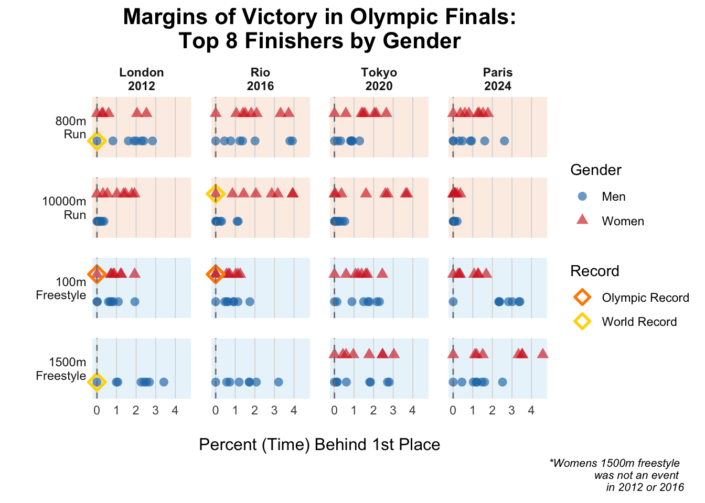

# Margins of victory in Olympic finals

A data visualisation critique and redesign in R. A figure from a 2025 physiology paper compares how closely men and women finish in Olympic finals. I deconstructed what it does well and badly, then rebuilt it with results from four Olympic Games.

Completed in 2025 during my Master of Data Science at RMIT University.



## The original

The original figure is from Joyner, Hunter and Senefeld (2025), [*Evidence on sex differences in sports performance*](https://doi.org/10.1152/japplphysiol.00615.2024), in the Journal of Applied Physiology. It shows how far behind the winner each of the top eight finishers was, as a percentage of the winning time, in the men's and women's 800 m and 10,000 m runs and 100 m and 1500 m freestyle swims at one Olympic Games. Its point is that women's fields tend to be more spread out than men's. The figure is not reproduced here for copyright reasons.

## What I changed

1. **Paired men and women within each event.** The original listed every event twice down one axis, once for women and once for men, so comparing the two meant jumping between rows. Each event now has its own row with both sexes side by side.
2. **Four Games, not one.** A single Olympics is not enough to say whether one sex's fields are consistently tighter. The rebuild covers London 2012, Rio 2016, Tokyo 2020 and Paris 2024.
3. **Records marked.** World and Olympic records are flagged, because a record-breaking winner stretches the gap to the rest of the field.

Panels are shaded by sport, and a dashed finish line at 0% makes the scale intuitive.

## What it shows

In the 10,000 m, the men's field finished more tightly than the women's at three of the four Games, and both were tight in Paris. In the other events the gap between the sexes changes from one Games to the next. That supports the critique: one Olympics is not enough to draw conclusions.

## Data

Results for the top eight in 30 finals were entered by hand from [Olympics.com](https://www.olympics.com) and [World Aquatics](https://www.worldaquatics.com), with sources for each final listed in the R Markdown. The women's 1500 m freestyle was not held before Tokyo 2020. Finish times are converted to seconds and expressed as a percentage behind the winner.

## Running it

Requires R with `tibble`, `dplyr`, `ggplot2` and `ggnewscale`. The data is in the R Markdown itself, so nothing else is needed.

```r
rmarkdown::render("olympic_margins.Rmd")
```
